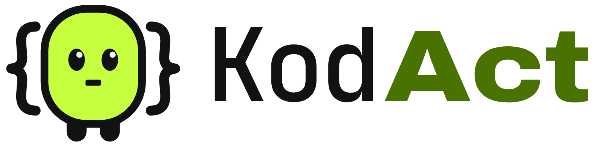

# KodAct logo

Kod is KodAct's logo and character: a block of code that does the work. Its
arms are curly braces and its mouth is the text cursor. The name says the
rest: KodAct, "Kod acts".



## Files

| File | Use |
| --- | --- |
| `kodact-logo.svg` | The logo, on light backgrounds |
| `kodact-logo-on-dark.svg` | The logo, on dark backgrounds |
| `kodact-logo-stacked.svg`, `kodact-logo-stacked-on-dark.svg` | The logo stacked, for square spaces |
| `kod.svg`, `kod-on-dark.svg` | Kod alone, in colour |
| `kod-mark.svg`, `kod-mark-paper.svg` | Kod in one colour: ink, or paper on dark |
| `kodact-wordmark.svg`, `kodact-wordmark-on-dark.svg` | The name alone |
| `app-icon.svg` | App icon, 48 px and up |
| `app-icon-small.svg` | App icon with bolder strokes, for 24 and 32 px |
| `app-icon-16.svg` | App icon drawn pixel by pixel for 16 px |
| `kodact.ico` | Windows icon, 16 to 256 px; the copy in `crates/kodact-cli/assets/` is built into kodact.exe |
| `favicon.ico` | Browser icon, 16, 32 and 48 px |
| `png/` | The files above as PNG, with transparent backgrounds |

On the app icon, the lime tile is Kod's body: what's left is its face, the
braces, eyes and cursor.

## Colours

These are the terminal palette's colours (`crates/kodact-cli/src/tui/palette.rs`).

| Colour | Hex | Where |
| --- | --- | --- |
| Lime | `#c6ff3d` | Kod's body; "Act" on dark backgrounds |
| Olive | `#4a7200` | "Act" on light backgrounds, where lime is too pale for text |
| Ink | `#101214` | Outlines, the face, "Kod" on light backgrounds |
| Paper | `#f2f0e9` | "Kod" on dark backgrounds, the light in Kod's eyes |

## Type

"Kod" is JetBrains Mono Medium and "Act" is Archivo ExtraBold at 114% width:
code type, then a heavy one, so the name reads as what it does. Both fonts
are under the SIL Open Font License 1.1. The SVG files hold the letters as
outlines, so nothing needs a font installed.

## Using it

- Leave clear space around the logo of at least half the width of Kod's body.
- Below 120 px wide, use Kod alone instead of the full logo. Below 24 px, use
  the app icon, which has its own 16 px drawing.
- Use the plain files on light backgrounds and the `-on-dark` files on dark
  ones. On a dark background, the plain version's ink braces disappear.
- Don't recolour Kod, stretch it, add shadows or glows, or redraw its face.

## Kod in the terminal

Kod's face is plain text, so it works in any terminal, over SSH and in logs.
The CLI doesn't use these faces yet.

| State | Face |
| --- | --- |
| Ready | `{o_o}` |
| Working | `{-_-}` |
| Needs your OK | `{o_o}?` |
| Done | `{^_^}` |
| A step failed | `{>_<}` |

## Editing

The SVG files are the masters. `source/build_svgs.py` writes them all from one
set of drawings:

```bash
pip install fonttools uharfbuzz
# Archivo[wdth,wght].ttf and JetBrainsMono[wght].ttf from github.com/google/fonts (ofl/),
# saved as archivo.ttf and jbmono.ttf in one folder
python3 source/build_svgs.py <output folder> <font folder>
```

The PNG files are the SVGs rendered at the sizes in their names; any SVG
renderer gives the same result.
